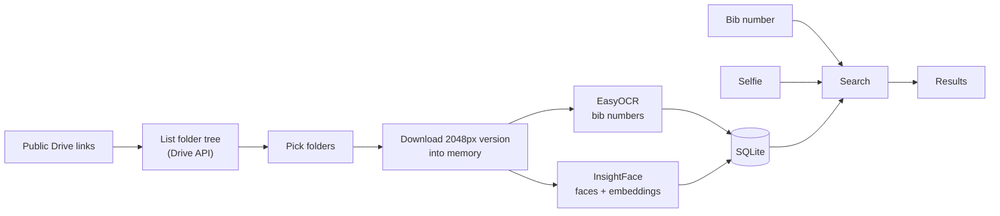

# Race Photo Finder

Find your photos among thousands of race photos using your bib number, your face, or both.

[Türkçe](README.tr.md)

Status: work in progress. The whole pipeline works (Google Drive -> OCR + face recognition -> search UI), but I haven't done a proper evaluation yet, so there are no accuracy numbers here. That's the next step.

## Why

I run trail races and half marathons. After every race the organisers put a few thousand photos on Google Drive and you have to scroll through all of them to find yourself. Every race organises the folders differently. Some examples from the races I tested with:

- one flat folder with ~1,400 photos
- one race split into 3 separate links (expo, half marathon, mixed), ~1,200 photos in total
- nested photographer / day / checkpoint folders, ~19,500 photos in 79 folders

So the tool has to accept multiple links, go through folders of any depth, and let you pick only the folders that matter (your distance, your day, the finish line, etc.).

Searching only by bib number isn't enough, because bibs get hidden under hydration vests or rain jackets, fold over, or are just too far away to read. Searching only by face isn't enough either, because of sunglasses, caps, and people looking down while running. So I use both, and a photo is returned if either one matches.

## How it works



There are two separate steps.

Indexing is the slow part and runs once per photo. Each photo is downloaded into memory, the bib numbers and faces are extracted and saved to SQLite, and then the photo is thrown away. Nothing is saved to disk.

Search is fast and you can run it as many times as you want. Bib search is just a SQL query. Face search computes the embedding of your selfie and compares it to all stored face embeddings with a single numpy matrix multiplication.

## What it can do

- Take one or more Drive links for the same race.
- Show the folders grouped by photographer, with a keyword box for selecting many folders at once. Matching ignores Turkish characters, spaces and dashes, so `odul` finds `ÖDÜL TÖRENİ` and `21k` finds `21 K`.
- Search by bib, by selfie, or both. Every result shows whether it matched by bib, by face (with the score), or both.
- Find you in the background of someone else's photo (start, expo, finish).
- Never scan the same photo twice. You can change the folder selection, and if a scan stops halfway it continues from where it left off.
- Change the face threshold, OCR confidence and background setting without rescanning.
- Show progress, remaining time, and errors while the scan is running.

## Design decisions

No training, only pretrained models. My first idea was to collect two datasets and train a face model and a digit model, but that doesn't fit this problem. Face recognition here is open-set: the model has never seen me, and there are no labels for thousands of runners. ArcFace embeddings plus a similarity threshold solve this directly. An MNIST-style digit model doesn't help either, because the bib first has to be found somewhere in a crowded photo before it can be read (scene text detection). The only things I need to tune are the thresholds.

InsightFace (ArcFace, `buffalo_l`) for faces, because it handles side views and motion blur better than dlib's `face_recognition`. EasyOCR for bibs, with a digits-only allowlist so it doesn't confuse O/0, I/1 or S/5.

SQLite instead of PostgreSQL. It's a single user app running locally, with around 15k faces per race. The similarity search happens in numpy, not in the database. All database code is in `database.py`, so moving to PostgreSQL + pgvector later (if it ever becomes a multi-user service) would mean changing one file.

A Drive API key instead of OAuth or scraping. An API key can read any public folder and is set up once by whoever runs the app. OAuth is only needed for private files, and Google requires a security review for public apps that use it. Scraping with `gdown` breaks at around 50 files per folder.

Downloading Drive's 2048px version instead of the original. The models never use more than 2048px anyway, and I measured it at about 6x less data per photo (0.82 MB vs 5.15 MB). If the small version isn't available it falls back to the original.

Store raw results and filter at search time. OCR readings are saved without a confidence cutoff, and faces down to 20px. All the thresholds are applied when searching, so changing them never needs a rescan.

OR instead of AND. Missing one of your own photos is worse than seeing one extra photo of a stranger, so recall matters more than precision here. Photos that match on both bib and face are shown first.

For evaluation the dev/test split will be done by race, not randomly. Photos from the same race share lighting, outfits and burst shots, so a random split would leak.

## Problems I ran into

Download speed. When I measured each stage separately, downloading one photo at a time (~1.2 s per photo) was the slowest part. I added a thread pool that downloads the next photos while the current one is being processed, which brought it down to ~0.15 s per photo. The number of photos waiting in memory is limited, so a fast download can't fill up the RAM.

`database is locked`, but only inside Streamlit. A scan was going at ~6.7 s per photo and not saving anything. It turned out Python's `sqlite3` module quietly opens a transaction before writing and keeps the lock until commit. Streamlit opens a new connection on every rerun and the old ones stay alive, so an old forgotten transaction was blocking every write until the 5 s timeout. The errors were only shown at the end of the scan, which is why it went unnoticed for a while. It never happened in my test scripts because they only used one connection. I fixed it with autocommit mode, explicit transactions only around the writes, and WAL. There is now a test that reproduces the lock, and errors are shown during the scan.

Fixing one detection case broke another. I raised the face detector size from 640 to 1024 to catch small faces in the background, and then it stopped finding faces in close-up selfies, because the face was too big for that scale. Now it detects at two scales (128 for close-ups, 1024 for far away faces), and there's a test that runs the real model on a close-up.

SQLite parameter limit. `WHERE id IN (...)` doesn't work with more than ~32k values and one race had ~20k photos. The selected IDs now go into a temp table that gets joined (tested with 40k IDs).

Some smaller ones:
- A Streamlit expander closed on every click because its title had a counter in it, and Streamlit identifies widgets by their label.
- The remaining time showed 4 hours at the start because model loading was counted in. Models are loaded before the timer now, and the estimate uses the last 30 photos.
- `str.lower()` doesn't handle Turkish İ and ı correctly.
- Drive returns some file names in Unicode NFD form.

EasyOCR runs on the GPU through PyTorch. InsightFace runs on the CPU (ONNX Runtime) for now. It's fast enough, and setting up CUDA for ONNX on a very new GPU wasn't worth the time yet.

## Privacy

Selfies are never saved. They're processed in memory and thrown away after the search.

Face embeddings count as biometric data (KVKK / GDPR), so the index stays on my machine and is in `.gitignore`. There are no photos or embeddings of any runner in this repo.

Only public Drive folders are read, and the API key is restricted to the Drive API.

## Setup

You need Python 3.12 and a Google Cloud API key with the Drive API enabled. An NVIDIA GPU is optional (used for OCR).

```bash
python3 -m venv .venv && source .venv/bin/activate
pip install -r requirements-local.txt     # includes PyTorch, a few GB

mkdir -p .streamlit
echo 'GOOGLE_API_KEY = "your-key"' > .streamlit/secrets.toml   # ignored by git

streamlit run app.py
```

For the API key: [Google Cloud Console](https://console.cloud.google.com) -> new project -> enable Google Drive API -> Credentials -> Create credentials -> API key, then restrict the key to the Drive API.

The OCR and face models (~400 MB) download on first use.

Tests:

```bash
pytest    # the tests that need the real face model are skipped if it isn't downloaded
```

## Project structure

```
app.py                  Streamlit UI
photo_finder/
├── config.py           paths, thresholds, model settings
├── download.py         Drive folder listing and in-memory download
├── images.py           image loading (EXIF rotation, resizing)
├── bibs.py             bib reading with EasyOCR
├── faces.py            face detection, embeddings, similarity
├── database.py         SQLite index
├── indexer.py          scan pipeline with prefetching
├── search.py           bib / face search and ranking
├── folders.py          folder grouping and keyword matching
└── evaluate.py         (not done yet) precision/recall, threshold selection
tests/
```

## Making it faster

Indexing is currently around 1 s per photo, so about 30 minutes for 2,000 photos. Downloading already happens in parallel, so the rest of the time is the models. Things I want to try, roughly in order:

- Run OCR only on the area under each detected face instead of the whole image. Bibs are almost always right below the face, and it would also stop it from reading numbers on ads and signs.
- Run OCR (GPU) and face detection (CPU) at the same time. Right now they run one after another on the same thread even though they use different hardware.
- Move the face models to ONNX Runtime GPU or TensorRT, and process all faces in a photo as one batch. Start photos can have 30+ faces.
- Batch several photos together for the GPU.
- Add face-only and bib-only scan modes, and remember which steps were done for each photo.
- List the Drive folders in parallel and cache the list (79 folders take about a minute right now).
- Scan the most likely folders first (your distance, the finish line) so results show up sooner.

I'm not planning to add FAISS or another approximate nearest neighbour index. With ~15k faces per race, the exact search in numpy already takes milliseconds.

## Roadmap

Evaluation (next):
- [ ] Label photos from 3-4 races, split dev/test by race, and measure precision and recall for bib only, face only and both, with and without background faces.
- [ ] Choose the thresholds on the dev set and report the results once on the test set.

Better results:
- [ ] A "this is me" button that adds confirmed race photos to the reference. In my first tests, real race photos matched much better than selfies taken at home, since the lighting, angle and gear are similar.
- [ ] Suggest the photos right next to a match (photographers shoot in bursts).
- [ ] Search for several people at once (friends, family, a running club).
- [ ] Rescan selected folders when detector settings change.

Usability:
- [ ] Mark the matched face in the results.
- [ ] Download selected results as a zip.
- [ ] Docker / one-command setup.

## Built with

Python, Streamlit, InsightFace, ONNX Runtime, EasyOCR, PyTorch, OpenCV, NumPy, SQLite, Google Drive API, pytest

## License

[MIT](LICENSE)
