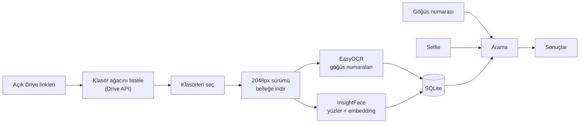

# Race Photo Finder

Binlerce yarış fotoğrafı arasından kendi fotoğraflarını göğüs numaranla, yüzünle ya da ikisiyle bul.

[English](README.md)

Durum: geliştirme aşamasında. Akışın tamamı çalışıyor (Google Drive -> OCR + yüz tanıma -> arama arayüzü), ama henüz düzgün bir değerlendirme yapmadım. Bu yüzden burada doğruluk sonucu yok, sıradaki adım o.

## Neden

Patika koşularına ve yarı maratonlara katılıyorum. Her yarıştan sonra organizatörler birkaç bin fotoğrafı Google Drive'a koyuyor ve kendini bulmak için hepsine tek tek bakman gerekiyor. Her yarış klasörleri farklı düzenliyor. Test ettiğim yarışlardan örnekler:

- tek bir düz klasörde ~1.400 fotoğraf
- 3 ayrı linke bölünmüş tek bir yarış (expo, yarı maraton, karışık), toplam ~1.200 fotoğraf
- fotoğrafçı / gün / kontrol noktası şeklinde iç içe klasörler, 79 klasörde ~19.500 fotoğraf

Bu yüzden araç birden fazla link kabul etmeli, her derinlikteki klasörleri gezebilmeli ve sadece işine yarayan klasörleri (kendi mesafen, günün, finiş vb.) seçmene izin vermeli.

Sadece göğüs numarasıyla aramak yetmiyor: numara su yeleğinin ya da yağmurluğun altında kalıyor, katlanıyor ya da okunamayacak kadar uzakta oluyor. Sadece yüzle aramak da yetmiyor: güneş gözlüğü, şapka, koşarken aşağı bakmak. O yüzden ikisini birlikte kullanıyorum, biri tutarsa fotoğraf geliyor.

## Nasıl çalışıyor



İki ayrı adım var.

İndeksleme yavaş olan kısım ve her fotoğraf için bir kez yapılıyor. Her fotoğraf belleğe indiriliyor, numaralar ve yüzler çıkarılıp SQLite'a kaydediliyor, sonra fotoğraf atılıyor. Diske hiçbir şey kaydedilmiyor.

Arama hızlı ve istediğin kadar tekrar edebilirsin. Numara araması basit bir SQL sorgusu. Yüz aramasında selfie'nin embedding'i çıkarılıyor ve kayıtlı tüm yüz embedding'leriyle tek bir numpy matris çarpımıyla karşılaştırılıyor.

## Neler yapabiliyor

- Aynı yarış için bir veya birden fazla Drive linki alabiliyor.
- Klasörleri fotoğrafçıya göre gruplu gösteriyor, anahtar kelimeyle toplu seçim yapılabiliyor. Eşleştirme Türkçe karakter, boşluk ve tireden etkilenmiyor: `odul` yazınca `ÖDÜL TÖRENİ`, `21k` yazınca `21 K` bulunuyor.
- Numarayla, selfie ile ya da ikisiyle arayabiliyor. Her sonuçta numarayla mı, yüzle mi (skoruyla) yoksa ikisiyle mi eşleştiği yazıyor.
- Başkasının fotoğrafında arka planda kalmışsan da buluyor (start, expo, finiş).
- Aynı fotoğrafı iki kez taramıyor. Klasör seçimini değiştirebilirsin, tarama yarıda kalırsa kaldığı yerden devam ediyor.
- Yüz eşiği, OCR güveni ve arka plan ayarı yeniden tarama gerektirmeden değiştirilebiliyor.
- Tarama sırasında ilerlemeyi, kalan süreyi ve hataları gösteriyor.

## Tasarım kararları

Eğitim yok, sadece hazır modeller. İlk aklıma gelen iki veri seti toplayıp bir yüz modeli ve bir rakam modeli eğitmekti, ama bu problem için uygun değil. Buradaki yüz tanıma open-set bir problem: model beni hiç görmedi ve binlerce koşucu için etiket yok. ArcFace embedding'leri ve bir benzerlik eşiği bunu doğrudan çözüyor. MNIST tarzı bir rakam modeli de işe yaramıyor, çünkü numaranın okunmadan önce kalabalık bir fotoğrafın içinde bulunması gerekiyor (sahne içi metin tespiti). Ayarlamam gereken tek şey eşikler.

Yüzler için InsightFace (ArcFace, `buffalo_l`), çünkü yandan çekimlerde ve hareket bulanıklığında dlib tabanlı `face_recognition`'dan daha iyi. Numaralar için EasyOCR, sadece rakam kabul edecek şekilde ayarlı, böylece O/0, I/1, S/5 karışmıyor.

PostgreSQL yerine SQLite. Tek kullanıcılı, yerelde çalışan bir uygulama ve yarış başına 15 bin civarı yüz var. Benzerlik araması veritabanında değil numpy'da yapılıyor. Veritabanı kodunun hepsi `database.py`'de, yani ileride çok kullanıcılı bir servise dönerse PostgreSQL + pgvector'e geçmek tek dosyayı değiştirmek demek.

OAuth ya da sayfa kazıma yerine Drive API anahtarı. API anahtarı herhangi bir açık klasörü okuyabiliyor ve uygulamayı çalıştıran kişi bir kez ayarlıyor. OAuth sadece özel dosyalar için gerekli ve onu kullanan herkese açık uygulamalar için Google güvenlik incelemesi istiyor. `gdown` ile kazıma ise klasör başına 50 dosya civarında takılıyor.

Orijinal yerine Drive'ın 2048 piksellik sürümünü indirmek. Modeller zaten 2048 pikselden fazlasını kullanmıyor. Ölçtüğümde fotoğraf başına yaklaşık 6 kat daha az veri çıktı (0.82 MB'a karşı 5.15 MB). Küçük sürüm yoksa orijinali indiriyor.

Ham sonuçları saklayıp filtreyi arama anında uygulamak. OCR okumaları güven eşiği olmadan, yüzler 20 piksele kadar kaydediliyor. Eşiklerin hepsi arama sırasında uygulanıyor, yani değiştirmek yeniden tarama gerektirmiyor.

VE yerine VEYA. Kendi fotoğraflarından birini kaçırmak, fazladan bir yabancının fotoğrafını görmekten daha kötü. Yani burada recall precision'dan önemli. Hem numarası hem yüzü tutan fotoğraflar en üstte gösteriliyor.

Değerlendirmede dev/test bölmesi rastgele değil yarışa göre yapılacak. Aynı yarışın fotoğraflarında ışık, kıyafet ve seri çekimler ortak, rastgele bölme veri sızıntısı yaratır.

## Karşılaştığım sorunlar

İndirme hızı. Her aşamayı ayrı ayrı ölçtüğümde en yavaş kısmın fotoğrafları tek tek indirmek olduğunu gördüm (~1.2 sn/foto). Mevcut fotoğraf işlenirken sıradakileri indiren bir thread havuzu ekledim, süre ~0.15 sn/fotoya düştü. Bellekte bekleyen fotoğraf sayısı sınırlı, hızlı bir indirme RAM'i dolduramıyor.

Sadece Streamlit içinde çıkan `database is locked`. Bir tarama fotoğraf başına ~6.7 sn sürüyordu ve hiçbir şey kaydetmiyordu. Meğer Python'un `sqlite3` modülü yazmadan önce sessizce bir transaction açıyor ve commit edilene kadar kilidi tutuyormuş. Streamlit her rerun'da yeni bağlantı açıyor ve eskiler açık kalıyor. Eskilerden birindeki unutulmuş transaction her yazmayı 5 saniyelik zaman aşımına kadar bekletiyordu. Hatalar sadece tarama bitince gösterildiği için bir süre fark edilmedi. Test betiklerimde hiç çıkmadı, çünkü orada tek bağlantı vardı. Autocommit modu, sadece yazma işlemlerinin etrafında açılan transaction'lar ve WAL ile düzelttim. Artık kilidi yeniden üreten bir test var ve hatalar tarama sırasında gösteriliyor.

Bir durumu düzeltirken başka birini bozmak. Arka plandaki küçük yüzleri yakalamak için yüz tespit boyutunu 640'tan 1024'e çıkardım, bu sefer yakın çekim selfie'lerde yüz bulamamaya başladı, çünkü yüz o ölçek için fazla büyüktü. Artık iki ölçekte tespit yapıyor (yakın çekimler için 128, uzaktakiler için 1024) ve gerçek modeli yakın çekim bir fotoğrafta çalıştıran bir test var.

SQLite parametre sınırı. `WHERE id IN (...)` 32 bin civarı değerden sonra çalışmıyor, bir yarışta ise ~20 bin fotoğraf vardı. Seçili ID'ler artık geçici bir tabloya yazılıp join ediliyor (40 bin ID ile test edildi).

Daha küçükleri:
- Streamlit'te açılır panel her tıklamada kapanıyordu, çünkü başlığında bir sayaç vardı ve Streamlit widget'ları başlıklarından tanıyor.
- Kalan süre başta 4 saat gösteriyordu, çünkü model yükleme süresi de hesaba katılıyordu. Modeller artık sayaçtan önce yükleniyor ve tahmin son 30 fotoğrafa göre yapılıyor.
- `str.lower()` Türkçe İ ve ı harflerini doğru çevirmiyor.
- Drive bazı dosya adlarını Unicode NFD biçiminde döndürüyor.

EasyOCR PyTorch üzerinden GPU'da çalışıyor. InsightFace şimdilik CPU'da (ONNX Runtime) çalışıyor. Yeterince hızlı ve çok yeni bir GPU'da ONNX için CUDA kurmakla uğraşmaya henüz değmedi.

## Gizlilik

Selfie'ler hiçbir zaman kaydedilmiyor. Bellekte işleniyor ve aramadan sonra atılıyor.

Yüz embedding'leri biyometrik veri sayılıyor (KVKK / GDPR). Bu yüzden indeks benim bilgisayarımda kalıyor ve `.gitignore`'da. Bu repoda hiçbir koşucunun fotoğrafı ya da embedding'i yok.

Sadece herkese açık Drive klasörleri okunuyor, API anahtarı da sadece Drive API ile sınırlı.

## Kurulum

Python 3.12 ve Drive API'si açık bir Google Cloud API anahtarı gerekiyor. NVIDIA GPU isteğe bağlı (OCR için kullanılıyor).

```bash
python3 -m venv .venv && source .venv/bin/activate
pip install -r requirements-local.txt     # PyTorch dahil, birkaç GB

mkdir -p .streamlit
echo 'GOOGLE_API_KEY = "anahtarin"' > .streamlit/secrets.toml   # git'e girmez

streamlit run app.py
```

API anahtarı için: [Google Cloud Console](https://console.cloud.google.com) -> yeni proje -> Google Drive API'yi etkinleştir -> Credentials -> Create credentials -> API key, sonra anahtarı Drive API ile sınırla.

OCR ve yüz modelleri (~400 MB) ilk kullanımda iniyor.

Testler:

```bash
pytest    # gerçek yüz modeline ihtiyaç duyan testler, model inmemişse atlanır
```

## Proje yapısı

```
app.py                  Streamlit arayüzü
photo_finder/
├── config.py           yollar, eşikler, model ayarları
├── download.py         Drive klasörlerini listeleme ve belleğe indirme
├── images.py           resim okuma (EXIF yönü, küçültme)
├── bibs.py             EasyOCR ile numara okuma
├── faces.py            yüz tespiti, embedding, benzerlik
├── database.py         SQLite indeksi
├── indexer.py          önden indirmeli tarama
├── search.py           numara / yüz araması ve sıralama
├── folders.py          klasör gruplama ve anahtar kelime eşleştirme
└── evaluate.py         (henüz yapılmadı) precision/recall, eşik seçimi
tests/
```

## Nasıl hızlandırılabilir

İndeksleme şu an fotoğraf başına 1 sn civarı, yani 2.000 fotoğraf yaklaşık 30 dakika. İndirme zaten paralel yapılıyor, kalan süre modellerden geliyor. Denemek istediklerim, kabaca öncelik sırasıyla:

- OCR'ı tüm resim yerine sadece bulunan yüzlerin altındaki bölgede çalıştırmak. Numara neredeyse her zaman yüzün hemen altında oluyor, ayrıca reklam ve tabelalardaki numaraları okumasının da önüne geçer.
- OCR'ı (GPU) ve yüz tespitini (CPU) aynı anda çalıştırmak. Farklı donanım kullanmalarına rağmen şu an aynı thread'de sırayla çalışıyorlar.
- Yüz modellerini ONNX Runtime GPU ya da TensorRT'ye taşımak ve bir fotoğraftaki tüm yüzleri tek seferde işlemek. Start fotoğraflarında 30'dan fazla yüz olabiliyor.
- GPU için birkaç fotoğrafı birlikte işlemek (batch).
- Sadece yüz ve sadece numara tarama modları eklemek ve her fotoğraf için hangi adımların yapıldığını kaydetmek.
- Drive klasörlerini paralel listelemek ve listeyi cache'lemek (79 klasör şu an bir dakika kadar sürüyor).
- En olası klasörleri önce taramak (kendi mesafen, finiş), böylece sonuçlar daha erken görünür.

FAISS gibi yaklaşık en yakın komşu araması eklemeyi düşünmüyorum. Yarış başına ~15 bin yüzde numpy ile tam arama zaten milisaniyeler sürüyor.

## Yol haritası

Değerlendirme (sıradaki):
- [ ] 3-4 yarıştan fotoğrafları etiketlemek, dev/test'i yarışa göre bölmek, sadece numara, sadece yüz ve ikisi için (arka plan yüzleri açık ve kapalı) precision ve recall ölçmek.
- [ ] Eşikleri dev setinde seçip sonucu test setinde bir kez raporlamak.

Daha iyi sonuçlar:
- [ ] Onaylanan yarış fotoğraflarını referansa ekleyen bir "bu benim" butonu. İlk testlerimde gerçek yarış fotoğrafları evde çekilmiş selfie'lerden çok daha iyi eşleşti, çünkü ışık, açı ve ekipman benzer.
- [ ] Bir eşleşmenin hemen yanındaki fotoğrafları da önermek (fotoğrafçılar seri çekiyor).
- [ ] Birden fazla kişiyi aynı anda aramak (arkadaşlar, aile, koşu kulübü).
- [ ] Tespit ayarları değişince seçili klasörleri yeniden taramak.

Kullanım:
- [ ] Sonuçlarda eşleşen yüzü işaretlemek.
- [ ] Seçilen sonuçları zip olarak indirmek.
- [ ] Docker / tek komutla kurulum.

## Kullanılanlar

Python, Streamlit, InsightFace, ONNX Runtime, EasyOCR, PyTorch, OpenCV, NumPy, SQLite, Google Drive API, pytest

## Lisans

[MIT](LICENSE)
